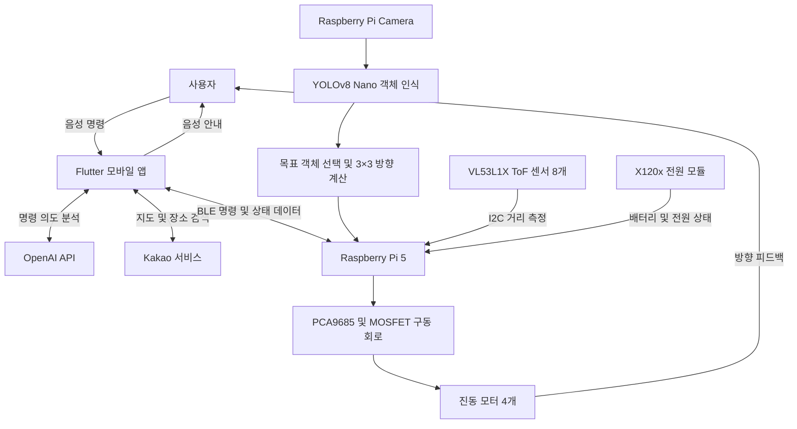

# AI Smart Cane

시각장애인의 주변 객체 탐색과 이동을 돕는 AI 기반 스마트 지팡이

## 1. 프로젝트 개요

### 1-1. 프로젝트 소개

- **프로젝트명:** AI Smart Cane
- **프로젝트 정의:** Raspberry Pi 5 기반 카메라 객체 인식과 ToF 거리 감지에 Flutter 모바일 앱을 연동하여, 주변 환경 정보를 진동과 음성으로 전달하는 보행 보조 시스템입니다.

### 1-2. 개발 배경 및 필요성

시각 정보에 의존하기 어려운 환경에서는 주변 물건의 종류와 위치를 파악하고 목적지를 찾아가는 데 어려움이 있습니다. 본 프로젝트는 거리 센서에 AI 객체 인식과 스마트폰 음성 인터페이스를 결합하여, 사용자가 원하는 물건을 탐색하고 주변 환경을 인지할 수 있도록 지원하는 것을 목표로 합니다.

### 1-3. 프로젝트 특장점

- **목표 객체 탐색:** YOLOv8 Nano로 카메라 영상에서 사용자가 지정한 객체를 찾습니다.
- **촉각 방향 안내:** 화면을 3×3 영역으로 나누고 진동 모터 4개를 조합하여 8방향과 중앙 정렬 상태를 전달합니다.
- **다중 거리 센서:** VL53L1X ToF 센서 8개로 거리를 측정하며, 연속 통신 오류 발생 시 센서를 재초기화합니다.
- **음성 중심 인터페이스:** 음성 명령 입력과 TTS 안내를 제공하며 BLE로 지팡이와 통신합니다.
- **상태 모니터링:** 배터리 잔량, 전압, 전원 및 CPU 상태 등을 확인합니다.

### 1-4. 주요 기능

| 기능 | 설명 |
| --- | --- |
| 목표 객체 탐색 | 앱에서 탐색 대상을 전달하고 YOLO로 해당 객체 탐지 |
| 객체 방향 안내 | 객체 중심점을 기준으로 방향을 계산하여 진동 출력 |
| 주변 거리 측정 | ToF 센서 8개의 거리 데이터 수집 및 BLE 전송 |
| 음성 명령·안내 | 음성 인식, 명령 의도 분석 및 TTS 안내 |
| 위치·길안내 | 앱에서 현재 위치 확인, 장소 검색, 경로 안내 및 장소 저장 |
| 기기 상태 확인 | 배터리·전원·CPU 상태를 앱으로 전달 |

> 현재 앱은 `GET_CLASSES`와 `NAV:*` 명령도 전송하지만, Raspberry Pi 통합 프로그램의 명령 처리기는 `PING`, `STATUS`, `STOP`, `FIND:<target>`을 처리합니다. 객체 목록 요청 및 길안내 진동 연동은 양쪽 통신 규격을 추가로 맞춰야 합니다.

### 1-5. 기대 효과 및 활용 분야

- 시각장애인의 주변 물건 탐색과 환경 인지 보조
- 음성과 진동을 활용한 정보 접근성 향상
- AI 객체 인식·거리 센서·모바일 앱을 결합한 보조공학 기기 연구 및 교육

### 1-6. 기술 스택

| 구분 | 기술·부품 |
| --- | --- |
| 메인 보드 | Raspberry Pi 5 |
| 객체 인식 | YOLOv8 Nano, Ultralytics, OpenCV, Picamera2 |
| 지팡이 소프트웨어 | Python, GPIOZero, SMBus2, BlueZ / D-Bus |
| 모바일 앱 | Flutter, Dart |
| 앱 주요 패키지 | flutter_blue_plus, speech_to_text, flutter_tts, geolocator, webview_flutter, shared_preferences |
| 외부 서비스 | OpenAI API 기반 명령 의도 분석, Kakao 지도·장소 검색 연동 |
| 거리 센서 | VL53L1X ToF × 8 |
| 진동 출력 | PCA9685, 진동 모터 × 4, MOSFET 구동 회로 |
| 전원·배터리 | X120x Raspberry Pi 전원 모듈 |

## 2. 팀원 소개

첨부된 역할 분담표를 기준으로 작성했습니다.

| 번호 | 성명 | 역할 | 담당 업무 |
| :---: | :---: | :---: | --- |
| 1 | 한호병 | 멘토 | 최종 컨펌 및 보완사항 수정 |
| 2 | 김봉현 | 지도교수 | 최종 컨펌 및 보완사항 수정 |
| 3 | 이승욱 | 팀장 | 프로젝트 총괄, Raspberry Pi 5 기반 시스템 통합, YOLOv8 Nano 객체 인식 및 방향 계산 로직 구현 |
| 4 | 이기승 | 팀원 2 | Flutter 모바일 앱 개발, 음성 명령 처리, BLE 통신 연동 및 사용자 인터페이스 구현 |
| 5 | 오세규 | 팀원 3 | ToF 센서 기반 장애물 감지, 8방향 진동 모터 제어, 하드웨어 회로 구성 및 테스트 |
| 6 | 조수호 | 팀원 4 | 소프트웨어 기능 테스트, BLE 통신 동작 확인, 객체 인식 결과 검증, 시연 영상 및 발표자료 제작 보조 |
| 7 | 권민호 | 팀원 5 | 하드웨어 조립 보조, ToF 센서 및 진동 모터 배선 점검, 전원·배터리 상태 확인, 통합 시연 환경 구성 보조 |

## 3. 시스템 구성도

### 3-1. 전체 구성



### 3-2. 객체 탐색 동작 과정

1. 사용자가 앱에서 음성으로 찾고 싶은 물건을 입력합니다.
2. 앱이 명령을 분석하고 BLE로 `FIND:<target>`을 전송합니다.
3. Raspberry Pi가 카메라 영상에 YOLO 객체 인식을 수행합니다.
4. 목표 클래스 중 신뢰도가 가장 높은 객체를 선택합니다.
5. 객체 중심점의 위치를 화면의 3×3 영역으로 분류합니다.
6. 해당 방향으로 진동을 출력하고 탐지 정보를 앱에 전달합니다.
7. `STOP` 명령을 수신하면 객체 탐색과 진동을 중지합니다.

### 3-3. 방향별 진동 출력

| 화면 내 방향 | 동작 모터 |
| --- | --- |
| 위 / 왼쪽 / 아래 / 오른쪽 | 각각 CH0 / CH1 / CH2 / CH3 |
| 왼쪽 위 / 오른쪽 위 | CH0 + CH1 / CH0 + CH3 |
| 왼쪽 아래 / 오른쪽 아래 | CH2 + CH1 / CH2 + CH3 |
| 중앙 | 모터 4개를 이용한 정렬 신호 |

## 4. 작품 소개영상

[](https://www.youtube.com/watch?v=TEN5dg4Zw1s)

이미지를 클릭하면 작품 소개영상으로 이동합니다.

[YouTube에서 영상 보기](https://www.youtube.com/watch?v=TEN5dg4Zw1s)

## 5. 핵심 소스코드

### 5-1. 객체 위치를 3×3 방향으로 변환

[통합 프로그램](smart_cane/main/smartcane.py)의 `bbox_to_direction`은 객체 바운딩 박스의 중심점을 구한 뒤, 화면의 가로·세로를 각각 3등분하여 방향을 결정합니다. 아래는 같은 함수의 서식을 간결하게 정리한 코드입니다.

```python
def bbox_to_direction(bbox, width=640, height=640):
    x1, y1, x2, y2 = bbox
    center_x = (x1 + x2) / 2
    center_y = (y1 + y2) / 2
    cell_w = width / 3
    cell_h = height / 3

    if center_x < cell_w:
        horizontal = "LEFT"
    elif center_x < cell_w * 2:
        horizontal = "CENTER"
    else:
        horizontal = "RIGHT"

    if center_y < cell_h:
        vertical = "TOP"
    elif center_y < cell_h * 2:
        vertical = "CENTER"
    else:
        vertical = "BOTTOM"

    if vertical == "CENTER" and horizontal == "CENTER":
        return "CENTER"
    if vertical == "CENTER":
        return horizontal
    if horizontal == "CENTER":
        return vertical
    return vertical + "+" + horizontal
```

### 5-2. 주요 구현 파일

| 파일 | 핵심 내용 |
| --- | --- |
| [시스템 통합 프로그램](smart_cane/main/smartcane.py) | BLE 명령 처리, 객체 탐색, 방향 계산, 진동 제어, ToF 복구 및 상태 전송 |
| [객체 탐지 모듈](smart_cane/vision/target_detection.py) | 카메라 입력, Letterbox 전처리, 목표 객체 탐지 및 방향 계산 |
| [방향별 진동 제어](smart_cane/motor/direction_motor.py) | PCA9685를 이용한 방향별 모터 출력 |
| [ToF 복구 테스트](smart_cane/tof/tof_recovery_test.py) | 거리 센서 읽기 및 오류 복구 테스트 |
| [BLE 서비스](smart_cane/ble/ble_service.py) | BlueZ / D-Bus 기반 GATT 서비스 및 데이터 송수신 |
| [Flutter 앱](flutter_app/lib/main.dart) | 음성 명령, BLE 연결, 객체 탐색 요청, 위치·길안내 및 상태 화면 |
| [TTS 서비스](flutter_app/lib/services/tts_service.dart) | 음성 출력 처리 |

## 6. 프로젝트 폴더 구성

```text
.
├── README.md
├── smart_cane/
│   ├── main/       # 전체 시스템 통합 실행
│   ├── vision/     # 카메라 및 객체 인식
│   ├── motor/      # 진동 모터 제어
│   ├── tof/        # ToF 센서 설정·측정·복구
│   ├── ble/        # BLE 통신
│   ├── battery/    # 배터리 및 전원 모니터링
│   └── models/     # 모델 설정 및 변환 도구
└── flutter_app/
    ├── lib/        # 모바일 앱 소스
    ├── pubspec.yaml
    └── secrets.example.json
```

## 7. 실행 방법

### 7-1. Raspberry Pi 지팡이

Raspberry Pi에 카메라, 센서, 모터 및 전원 모듈을 연결하고 Python 의존 라이브러리와 I2C·카메라·Bluetooth 환경을 준비합니다. 하드웨어 세부 정보는 [지팡이 문서](smart_cane/README.md)를 참고하세요.

현재 통합 프로그램의 `YOLO_MODEL_PATH`는 `yolov8n.pt`입니다. 아래 실행 위치인 `smart_cane/`에 모델 파일을 배치하거나 코드의 모델 경로를 실제 위치에 맞게 수정합니다. 모델 가중치는 저장소에 포함되지 않습니다.

저장소 루트에서 실행합니다.

```bash
cd smart_cane
python3 main/smartcane.py
```

통합 프로그램은 기본적으로 카메라 창을 표시합니다. 화면 없이 실행할 경우 코드의 `SHOW_CAMERA_WINDOW` 설정을 확인하세요.

### 7-2. Flutter 모바일 앱

`flutter_app/secrets.example.json`을 같은 폴더의 `secrets.json`으로 복사한 뒤 다음 값을 입력합니다.

- `OPENAI_API_KEY`
- `KAKAO_REST_API_KEY`
- `KAKAO_JAVASCRIPT_KEY`

저장소 루트에서 실행합니다.

```bash
cd flutter_app
flutter pub get
flutter run --dart-define-from-file=secrets.json
```

앱에서 Bluetooth·마이크·위치 권한을 허용하고 지팡이에 연결한 뒤 기능을 사용합니다.
