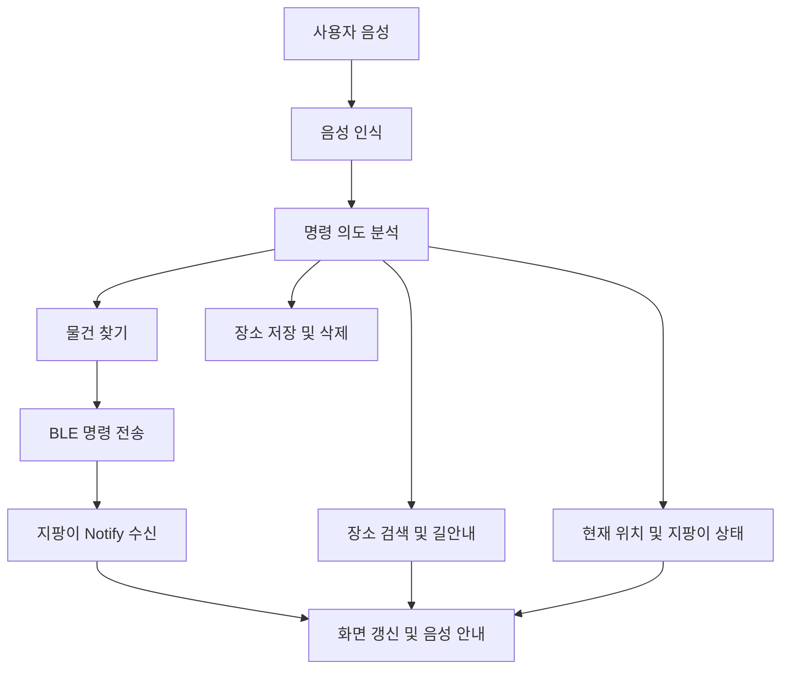

# SmartCane — Flutter 모바일 앱

[프로젝트 전체 소개](../README.md) · [Raspberry Pi 지팡이 문서](../smart_cane/README.md)

시각장애인을 위한 스마트 지팡이의 모바일 인터페이스입니다. 한국어 음성 명령을 분석하고 BLE로 객체 탐색을 요청하며, 음성 안내·현재 위치 확인·장소 저장·길안내·기기 상태 확인을 제공합니다.

## 1. 개발 환경과 지원 범위

| 항목 | 저장소 설정 |
| --- | --- |
| 프레임워크 | Flutter / Dart |
| Dart SDK 제약 | `^3.11.4` (`pubspec.yaml`) |
| 패키지명 | `flutter_application_1` |
| Android 앱 표시명 | `SmartCane` |
| Android applicationId | `com.example.flutter_application_1` |
| Android 최소 SDK | 24 |
| Java / Kotlin JVM 대상 | 17 |
| 앱 버전 | `1.0.0+1` |

실제 BLE·마이크·GPS를 사용하는 스마트폰에서 기능을 확인해야 합니다. 플랫폼 폴더가 존재하는 것만으로 모든 플랫폼의 기능 지원이 검증된 것은 아닙니다.

## 2. 주요 기능

| 기능 | 구현 내용 |
| --- | --- |
| 음성 명령 | `speech_to_text`로 입력하고 명령 의도 및 대상을 분석 |
| 명령 의도 분석 | OpenAI API를 호출하여 물건 찾기·길안내·상태 확인 등의 동작으로 분류 |
| 음성 출력 | 한국어 TTS로 안내하며 새 발화 전 기존 발화를 중지 |
| 지팡이 연결 | 이름이 `SmartCane`인 BLE 장치를 검색하고 GATT 특성에 연결 |
| 물건 찾기 | 탐색 대상을 지팡이에 전송하고 객체 방향 알림 처리 |
| 현재 위치 | GPS 위치와 주소 정보를 이용한 위치 안내 |
| 길안내 | 장소 검색, 경로 요청, 지도 표시, 위치·방향 기반 안내, 경로 재탐색 |
| 장소 관리 | 집·회사 등 장소를 저장하고 다시 목적지로 사용 |
| 상태 확인 | 지팡이 배터리·충전 상태·경고 수신 및 음성 안내 |
| 설정·진단 | 연결 상태와 BLE 송수신 로그 확인, 안내 관련 설정 관리 |

화면은 홈·길안내·설정의 3개 탭으로 구성됩니다. 길안내 중 객체 탐색으로 전환하거나 객체 탐색 종료 후 길안내를 이어가는 처리도 포함합니다.

## 3. 소스 구조

```text
flutter_app/
├── lib/
│   ├── main.dart                 # 앱 화면, 상태, 음성·BLE·지도·길안내 로직
│   └── services/
│       └── tts_service.dart       # 한국어 TTS 초기화·발화·중지
├── android/                      # Android 권한·빌드·앱 리소스
├── ios/                          # iOS 프로젝트 기본 구성
├── test/widget_test.dart         # MyApp 생성 확인 테스트
├── pubspec.yaml                  # SDK 제약 및 의존성
├── pubspec.lock                  # 의존성 버전 잠금
└── secrets.example.json          # API 키 설정 예시
```

주요 클래스는 `MyApp`, `VoiceCommandPage`, `IntentAnalysisResult`, `BleLogEntry`, `SavedPlace`, `KakaoPlace`, `KakaoWalkRoute`, `KakaoNavigationStep`입니다. 대부분의 화면과 서비스 연동이 현재 `main.dart`에 모여 있습니다.

## 4. 주요 패키지

| 패키지 | 용도 |
| --- | --- |
| `http` | 명령 분석·지도 관련 HTTP 요청 |
| `speech_to_text` | 음성 인식 |
| `flutter_tts` | TTS 음성 안내 |
| `flutter_blue_plus` | BLE 검색·연결·쓰기·Notify 구독 |
| `geolocator` | 현재 위치 및 위치 추적 |
| `flutter_device_compass` | 기기 방향 확인 |
| `webview_flutter` | Kakao 지도 WebView 표시 |
| `shared_preferences` | 장소와 사용자 설정 저장 |
| `wakelock_plus` | 화면 유지 처리 |

정확한 의존성 선언은 [pubspec.yaml](pubspec.yaml)을 확인하세요.

## 5. API 키 설정 및 실행

아래 명령은 이 폴더에서 실행합니다.

1. Flutter SDK와 Android 개발 환경을 준비하고 실기기를 연결합니다.
2. `secrets.example.json`을 `secrets.json`으로 복사합니다.
3. 아래 세 항목에 실제 키를 입력합니다.

```json
{
  "OPENAI_API_KEY": "YOUR_OPENAI_API_KEY",
  "KAKAO_REST_API_KEY": "YOUR_KAKAO_REST_API_KEY",
  "KAKAO_JAVASCRIPT_KEY": "YOUR_KAKAO_JAVASCRIPT_KEY"
}
```

| 설정 | 코드에서 사용하는 위치 |
| --- | --- |
| `OPENAI_API_KEY` | 음성 명령 의도 분석 및 텍스트 처리 |
| `KAKAO_REST_API_KEY` | 장소·주소 검색 및 경로 요청 |
| `KAKAO_JAVASCRIPT_KEY` | WebView 지도 SDK 로드 |

키는 `String.fromEnvironment`로 읽으므로 실행·빌드 때 `--dart-define-from-file`을 전달해야 합니다. 실행 중 JSON 파일을 직접 읽는 방식이 아닙니다. 키를 바꾼 뒤에는 앱을 다시 실행하거나 빌드하세요. 실제 키가 들어간 `secrets.json`은 커밋하지 않습니다.

```bash
flutter doctor
flutter pub get
flutter devices
flutter run --dart-define-from-file=secrets.json
```

Android APK 생성:

```bash
flutter build apk --dart-define-from-file=secrets.json
```

현재 Android release 빌드도 debug 서명을 사용하도록 설정되어 있습니다. 배포용 서명 설정은 별도로 필요합니다.

## 6. 권한과 외부 연결

Android Manifest에는 인터넷, 마이크, 위치, BLE 검색·연결, 위치 포그라운드 서비스, 알림, Wake Lock 권한이 선언되어 있습니다. 실제 기기에서 필요한 런타임 권한과 Bluetooth·위치 서비스를 허용해야 합니다.

음성 명령 분석과 지도·장소·경로 요청에는 네트워크가 필요합니다. BLE 연결 성공과 외부 API 호출 성공은 별도로 확인해야 합니다.

코드는 Kakao 호스트의 `/v2/routing/walk`에 `route_mode=ACCESSIBLE`로 경로를 요청합니다. 이는 현재 구현의 요청 방식이며, 실제 사용 가능 여부와 응답 호환성은 사용하는 서비스의 권한 및 실기기 호출 결과로 확인해야 합니다.

## 7. 음성 명령 처리 흐름



명령 예시는 다음과 같습니다. 실제 인식 결과와 실행 여부는 연결 상태·분석 결과·지원 객체 목록에 따라 달라집니다.

| 예시 | 의도 |
| --- | --- |
| “지팡이 연결해줘” / “연결 끊어줘” | 연결 / 연결 해제 |
| “휴대폰 찾아줘” | 객체 탐색 |
| “지금 어디야?” | 현재 위치 확인 |
| “배터리 얼마나 남았어?” | 지팡이 상태 확인 |
| “집으로 안내해줘” | 목적지 길안내 |
| “현재 위치를 집으로 저장해줘” | 장소 저장 |
| “다시 말해줘” / “중지해줘” | 안내 반복 / 동작 중지 |

취소나 새 명령 이후 늦게 도착한 분석 결과·객체 알림을 무시하기 위한 명령 세대 값(`_commandEpoch`)과 탐색 대상 검사가 있습니다. BLE 쓰기는 큐로 처리하여 앞선 쓰기 뒤에 중지 명령을 전달합니다.

## 8. BLE 통신 규격과 현재 연동 범위

| 항목 | 값 |
| --- | --- |
| 검색 장치명 | `SmartCane` |
| 서비스 UUID | `12345678-1234-5678-1234-56789abcdef0` |
| 특성 UUID | `12345678-1234-5678-1234-56789abcdef1` |
| 앱 → 지팡이 | UTF-8 문자열 쓰기 |
| 지팡이 → 앱 | Notify, UTF-8 텍스트 또는 JSON |

연결 후 서비스·특성을 검색하고 Notify를 활성화합니다. 수신 알림은 UTF-8로 디코딩한 뒤 JSON의 `type`을 기준으로 처리합니다.

| 명령·메시지 | 앱 동작 | 현재 지팡이 통합 코드 |
| --- | --- | --- |
| `FIND:<target>` | 목표 객체 탐색 요청 | 처리함 |
| `STOP` | 객체 탐색 중지 | 처리함 |
| `STATUS` / `PING` | 지팡이 지원 명령 | 처리함 |
| `GET_CLASSES` | 물건 찾기 전에 YOLO 지원 객체 목록 요청 | 처리함 (`object_classes`로 6개씩 분할 응답) |
| `NAV:FORWARD`, `NAV:LEFT`, `NAV:RIGHT`, `NAV:UTURN`, `NAV:STOP` | 길안내 진동 요청 | 처리함 (`navigation_motor` 응답) |
| `HAZARD:ON`, `HAZARD:OFF`, `HAZARD:DIST:<cm>`, `HAZARD:DIST:DEFAULT` | 설정 탭의 위험 감지 사용 여부와 안내 거리(20~200 cm) 전달 | 처리함 (`hazard_setting` 응답) |
| `type=status` | 배터리·충전·경고 반영 | 전송함 |
| `type=object` | 목표 객체 방향 안내 | 전송함 |
| `type=object_classes` | 객체 목록 청크 조립 후 물건 찾기 대상 확인에 사용 | 전송함 |
| `type=hazard`, `hazard_setting`, `navigation_motor` | 위험 알림·설정 응답·길안내 모터 상태 처리 | 전송함 |
| `type=search`, `tof`, `tof_recovery`, `error` | BLE 로그에만 표시, 거리값은 화면 상태로 반영하지 않음 | 전송함 |

물건 찾기 명령은 지팡이에서 받은 객체 목록에 있는 클래스만 `FIND:`로 전송합니다. 연결 직후 목록이 비어 있으면 `GET_CLASSES`를 먼저 요청하고, 지팡이가 `not_ready`(YOLO 로딩 전)를 응답하거나 목록을 받지 못하면 물건 찾기를 시작하지 않습니다.

지팡이 객체 알림 예시:

```json
{"type":"object","target":"cell phone","confidence":0.91,"direction":"TOP+LEFT"}
```

한 번의 Notify에 들어온 문자열을 직접 JSON으로 해석하므로, 메시지가 잘리거나 여러 알림으로 분리되면 파싱에 실패할 수 있습니다. 현재 양쪽 코드에는 일반 JSON 메시지에 대한 공통 분할·재조립 규격이 없습니다.

## 9. 데이터 저장과 음성 출력

저장 장소는 `SharedPreferences`의 `saved_places_v1` 키에 JSON 목록으로 보관합니다. 사용자 설정과 초기 안내 관련 상태도 로컬 저장소를 사용합니다.

[TTS 서비스](lib/services/tts_service.dart)의 기본값은 한국어 `ko-KR`, 발화 속도 `0.45`, 볼륨 `1.0`, 피치 `1.0`입니다. 발화 완료를 기다리며, 새 발화 전에 기존 음성을 중지합니다.

## 10. 확인 방법과 문제 해결

개발 확인 명령:

```bash
flutter analyze
flutter test
```

현재 `widget_test.dart`는 `MyApp` 생성만 확인합니다. BLE 연결·음성 인식·GPS·외부 API·실제 화면 전환을 검증하는 테스트는 아닙니다.

실기기에서는 지팡이 검색 → 연결 → Notify 수신 → 상태 표시 → 음성 명령 → 객체 방향 안내 순서로 확인합니다. 위치·장소 저장·길안내와 중지 동작도 별도로 확인합니다.

| 증상 | 확인할 내용 |
| --- | --- |
| 지팡이를 찾지 못함 | 장치명이 `SmartCane`인지, 지팡이 BLE 실행 상태, 검색 권한 및 Bluetooth 상태 |
| 연결 후 서비스 확인 실패 | 두 코드의 서비스·특성 UUID 일치 여부 |
| 연결되지만 물건 찾기가 시작되지 않음 | `GET_CLASSES` 응답이 `not_ready`인지(지팡이 YOLO 로딩 전), 객체 목록 수신 여부, 요청한 물건이 목록에 있는 클래스인지 |
| 지팡이 길안내 진동이 없음 | `navigation_motor` 응답의 `state`(`motor_unavailable`, `invalid`), 지팡이가 객체 탐색·장애물 경고 진동을 출력 중인지 |
| 음성 입력이 안 됨 | 마이크 권한, 음성 인식 서비스 사용 가능 여부 |
| 명령 분석 실패 | API 키의 빌드 주입, 네트워크, 서버 오류 응답 |
| 지도가 비거나 경로 요청 실패 | Kakao 키·서비스 사용 권한·WebView 오류·경로 API 응답 |
| 배터리 정보가 갱신되지 않음 | Notify 구독과 지팡이 `USE_X120X` 설정, 상태 패킷 수신 |
| JSON 파싱 실패 | BLE 로그의 원문과 메시지 잘림 여부 |
