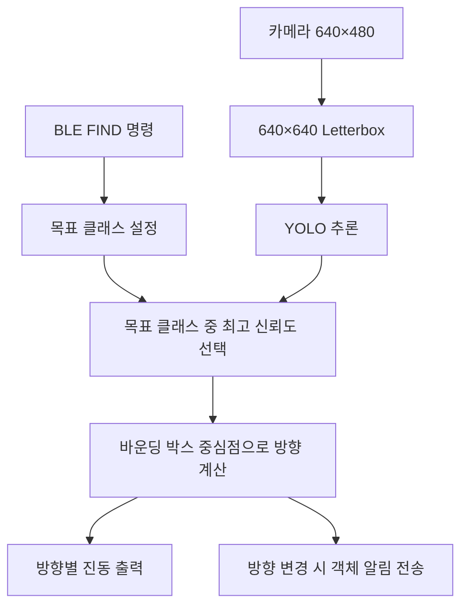

# AI Smart Cane — Raspberry Pi 지팡이

[프로젝트 전체 소개](../README.md) · [Flutter 모바일 앱 문서](../flutter_app/README.md)

Raspberry Pi 5에서 카메라 객체 인식, ToF 거리 측정, 방향별 진동 출력, BLE 통신 및 배터리 모니터링을 실행하는 하드웨어·Python 소프트웨어 파트입니다.

## 1. 주요 기능과 구현 범위

| 기능 | 구현 내용 |
| --- | --- |
| 객체 탐색 | BLE로 전달받은 목표 클래스를 YOLOv8 Nano로 탐지 |
| 객체 선택 | 동일 클래스가 여러 개면 신뢰도가 가장 높은 객체 선택 |
| 방향 계산 | 바운딩 박스 중심점을 화면의 3×3 영역으로 분류 |
| 진동 출력 | 진동 모터 4개를 조합하여 8방향 및 중앙 정렬 신호 출력 |
| 거리 측정 | VL53L1X ToF 센서 8개의 거리 측정·출력·BLE 전송 |
| 센서 오류 복구 | 연속 오류 감지 후 ToF 센서 재초기화 |
| BLE | BlueZ / D-Bus 기반 GATT 서비스 |
| 상태 모니터링 | X120x 배터리·전원 상태와 Raspberry Pi CPU 상태 전송 |

현재 통합 프로그램의 진동 출력은 목표 객체의 화면 내 방향을 기준으로 합니다. ToF 거리 데이터를 장애물 위험 등급으로 변환하거나 거리 임계값에 따라 경고 진동을 발생시키는 통합 로직은 포함되어 있지 않습니다.

## 2. 폴더 및 실행 파일

```text
smart_cane/
├── main/
│   └── smartcane_full_integration.py  # 전체 시스템 통합
├── vision/
│   ├── camera_test.py                # 카메라 확인
│   ├── target_detection.py           # 목표 객체·방향 인식
│   └── yolo_ncnn_test.py              # NCNN 추론 확인
├── motor/
│   ├── pca9685_test.py                # PCA9685 확인
│   ├── motor_test.py                  # 모터 출력 테스트
│   └── direction_motor.py             # 방향별 진동 제어
├── tof/
│   ├── tof_address_setup.py           # 다중 센서 주소 설정
│   ├── tof_multi_test.py              # 다중 거리 측정
│   └── tof_recovery_test.py           # 오류 복구 확인
├── ble/ble_service.py                 # 독립 BLE 서비스 모듈
├── battery/battery_monitor.py         # 배터리 모니터링
└── models/
    ├── model_config.py                # 개별 비전 모듈의 모델 설정
    ├── export_ncnn.py                 # NCNN 모델 변환
    └── README.md
```

통합 프로그램은 BLE·센서·모터 처리를 파일 내부에 구현합니다. 개별 모듈의 설정을 수정해도 통합 프로그램 설정이 자동으로 바뀌지는 않습니다.

## 3. 하드웨어 구성

| 부품 | 수량 | 용도 |
| --- | :---: | --- |
| Raspberry Pi 5 | 1 | 영상 추론·센서 제어·BLE 통신 |
| Raspberry Pi Camera | 1 | 객체 탐색용 영상 입력 |
| VL53L1X ToF | 8 | 주변 거리 측정 |
| PCA9685 | 1 | 모터 PWM 제어 |
| 진동 모터 | 4 | 상·좌·하·우 및 조합 방향 안내 |
| MOSFET 구동 회로 | 구성에 따름 | 모터 구동 |
| X120x 전원 모듈 | 1 | 전원 공급 및 배터리 상태 확인 |

### 3-1. ToF 주소와 XSHUT 매핑

아래 GPIO 번호는 BCM 번호입니다. 센서의 실제 장착 방향은 코드에 정의되어 있지 않으므로 센서 번호와 물리적 방향의 대응은 조립 구성에 맞춰 기록해야 합니다.

| 센서 번호 | I2C 주소 | XSHUT GPIO |
| :---: | :---: | :---: |
| 1 | `0x2A` | GPIO17 |
| 2 | `0x2B` | GPIO27 |
| 3 | `0x2C` | GPIO22 |
| 4 | `0x2D` | GPIO23 |
| 5 | `0x2E` | GPIO24 |
| 6 | `0x2F` | GPIO25 |
| 7 | `0x30` | GPIO5 |
| 8 | `0x31` | GPIO26 |

프로그램은 XSHUT를 제어하여 센서를 순서대로 초기화하고 개별 주소를 부여합니다. 센서 초기 주소가 같으므로 다중 센서 구성에서는 이 초기화 순서가 필요합니다.

### 3-2. 진동 모터 채널

| 방향 | PCA9685 채널 |
| --- | --- |
| 위 `TOP` | CH0 |
| 왼쪽 `LEFT` | CH1 |
| 아래 `BOTTOM` | CH2 |
| 오른쪽 `RIGHT` | CH3 |
| 왼쪽 위 `TOP+LEFT` | CH0 + CH1 |
| 오른쪽 위 `TOP+RIGHT` | CH0 + CH3 |
| 왼쪽 아래 `BOTTOM+LEFT` | CH2 + CH1 |
| 오른쪽 아래 `BOTTOM+RIGHT` | CH2 + CH3 |
| 중앙 `CENTER` | CH0 + CH1 + CH2 + CH3 |

여기서 방향은 카메라 화면상의 위치입니다. 진동 모터는 8개가 아니라 4개이며, 두 모터의 조합으로 대각선 방향을 전달합니다.

### 3-3. 전원 모듈

통합 코드의 X120x I2C 주소는 `0x36`, 외부 전원 감지용 PLD 핀은 GPIO6입니다. 배터리 잔량·전압과 전원 상태를 읽고, `vcgencmd` 및 시스템 정보를 이용해 CPU 관련 상태도 수집합니다.

회로의 상세 전원 배선과 부품 정격은 이 저장소에 포함된 소프트웨어 설정만으로 확정할 수 없습니다. 실제 제작 회로를 기준으로 연결해야 합니다.

## 4. 소프트웨어와 환경 준비

Raspberry Pi에서 다음 구성 요소를 사용할 수 있어야 합니다.

| 구분 | 라이브러리·도구 |
| --- | --- |
| 영상 | OpenCV (`cv2`), Picamera2 |
| 객체 인식 | Ultralytics YOLO |
| I2C·GPIO | `board`, `busio`, `digitalio`, GPIOZero, SMBus2 |
| 센서 | Adafruit VL53L1X |
| PWM | Adafruit PCA9685 |
| BLE | BlueZ, `btmgmt`, Python D-Bus, PyGObject (`gi`, GLib) |
| 시스템 상태 | `vcgencmd` 등 Raspberry Pi 시스템 도구 |

카메라·I2C·Bluetooth를 사용할 수 있도록 OS 환경을 준비합니다. 저장소에는 의존성을 일괄 설치하는 requirements 파일이 없으므로 실제 Raspberry Pi OS와 Python 환경에 맞춰 의존성을 설치해야 합니다.

통합 프로그램은 시작 시 `btmgmt connectable on`, `advertising on`, `discov on`을 실행합니다. 일반 사용자로 실행하면 해당 명령에 `sudo`를 붙이며, Bluetooth 설정 실패 시 시작이 중단됩니다.

## 5. 모델 준비와 실행

아래 명령은 `smart_cane/` 폴더에서 실행합니다.

### 5-1. 통합 프로그램

```bash
python3 main/smartcane_full_integration.py
```

기본 모델 경로는 현재 작업 폴더 기준 `yolov8n.pt`입니다. 모델 파일을 `smart_cane/yolov8n.pt`에 배치하거나 통합 프로그램의 `YOLO_MODEL_PATH`를 수정합니다. 모델 가중치는 Git에 포함되지 않습니다.

프로그램은 BLE → 배터리 → ToF → 모터 → YOLO → 카메라 순으로 초기화합니다. 이후 메인 루프에서 BLE 이벤트, 주기 상태 전송, 거리 측정·복구 및 객체 탐색을 처리합니다.

기본적으로 카메라 창을 표시하며 `q` 또는 `Ctrl+C`로 종료합니다. 종료 시 센서·모터·카메라 자원을 정리합니다. 화면 없는 환경에서는 `SHOW_CAMERA_WINDOW=False`로 설정합니다.

### 5-2. 통합 프로그램의 주요 설정

설정 위치: [main/smartcane_full_integration.py](main/smartcane_full_integration.py)

| 설정 | 기본값 | 의미 |
| --- | --- | --- |
| `USE_CAMERA`, `USE_YOLO`, `USE_MOTOR`, `USE_X120X`, `USE_TOF` | 모두 `True` | 각 기능 사용 여부 |
| `SHOW_CAMERA_WINDOW` | `True` | OpenCV 화면 표시 |
| `YOLO_MODEL_PATH` | `yolov8n.pt` | 통합 프로그램 모델 경로 |
| `CONFIDENCE_THRESHOLD` | `0.35` | 객체 탐지 임계값 |
| `WIDTH`, `HEIGHT` | `640`, `640` | Letterbox 후 영상 크기 |
| `PCA9685_FREQUENCY` | `1000` | PWM 주파수, Hz |
| `MOTOR_STRENGTH_PERCENT` | `30` | 모터 출력 비율 |
| `MOTOR_UPDATE_INTERVAL` | `0.25` | 모터 갱신 간격, 초 |
| `TOF_DISTANCE_MODE` | `2` | 센서 거리 모드 |
| `TOF_TIMING_BUDGET_MS` | `100` | ToF 측정 시간 예산, ms |
| `TOF_READ_INTERVAL_SEC` | `0.10` | 거리 읽기 간격, 초 |
| `TOF_PRINT_INTERVAL_SEC`, `TOF_BLE_INTERVAL_SEC` | `0.50` | 거리 출력·전송 간격, 초 |
| `TOF_MAX_CONSECUTIVE_ERRORS` | `5` | 복구 요청 기준 연속 오류 수 |
| `TOF_RECOVERY_COOLDOWN_SEC` | `2.0` | 복구 간 대기 간격, 초 |
| `TOF_RECOVERY_SETTLE_SEC` | `1.0` | 복구 후 안정화 시간, 초 |
| `STATUS_INTERVAL_SEC` | `5` | 상태 전송 간격, 초 |

주기 값은 메인 루프의 검사 기준입니다. YOLO 추론 등 같은 루프의 작업 시간이 길면 실제 측정·전송 간격도 길어질 수 있습니다. 기능 스위치를 꺼도 파일 상단의 관련 import는 수행되므로, 미설치 라이브러리 문제를 스위치만으로 해결할 수는 없습니다.

### 5-3. 개별 비전 모듈과 NCNN

[models/model_config.py](models/model_config.py)의 모델 경로는 통합 프로그램과 별개입니다.

- PyTorch 모델: `models/yolov8n.pt`
- NCNN 모델: `models/yolov8n_ncnn_model`
- 입력 크기: 640×640, 임계값: 0.35

모델 변환과 비전 모듈 실행:

```bash
python3 models/export_ncnn.py
python3 -m vision.target_detection
python3 -m vision.yolo_ncnn_test
```

`-m` 실행은 `models.model_config`를 저장소 내 패키지 경로로 찾도록 이 폴더를 기준으로 실행하는 방식입니다. NCNN 변환 도구가 존재하더라도 현재 통합 프로그램이 자동으로 NCNN 모델을 선택하는 것은 아닙니다.

## 6. 객체 탐색 처리



화면의 가로·세로를 각각 3등분하여 9개 영역을 사용합니다.

```text
TOP+LEFT       TOP        TOP+RIGHT
LEFT           CENTER     RIGHT
BOTTOM+LEFT    BOTTOM     BOTTOM+RIGHT
```

`FIND:cell phone`처럼 모델의 클래스명과 일치하는 문자열을 전달해야 합니다. 통합 코드의 클래스 비교는 정확한 문자열 일치 방식입니다. 목표를 찾지 못하면 진동을 중지하고 탐색 상태를 유지합니다. 객체 알림은 방향이 바뀔 때 전송하며, 미탐지 후 다시 찾은 경우에도 전송됩니다.

## 7. BLE 규격

| 항목 | 값 |
| --- | --- |
| 서비스 UUID | `12345678-1234-5678-1234-56789abcdef0` |
| 특성 UUID | `12345678-1234-5678-1234-56789abcdef1` |
| 수신 | UTF-8 문자열 Write |
| 송신 | UTF-8 텍스트·JSON Notify |

Flutter 앱은 장치명 `SmartCane`으로 검색합니다. Raspberry Pi가 해당 이름으로 검색되는지 별도로 확인해야 합니다. 통합 코드의 `btmgmt` 시작 설정은 광고·검색 가능 상태를 켜지만 장치명을 지정하지는 않습니다.

### 7-1. 지원 명령

| 명령 | 처리 결과 |
| --- | --- |
| `PING` | `PONG FROM PI` 응답 |
| `STATUS` | 현재 상태 JSON 전송 |
| `FIND:<target>` | 객체 탐색 시작, `search/started` 전송 |
| `STOP` | 객체 탐색·모터 중지, `search/stopped` 전송 |

Notify 구독 시작 시 `HELLO FROM PI` 텍스트를 전송합니다. 명령 처리기에서 `FIND:` 접두사는 대문자로 전달해야 합니다. 빈 목표는 탐색을 시작하지 않습니다.

### 7-2. 송신 데이터

다음 JSON은 형식 설명을 위한 예시 값입니다.

객체 탐지:

```json
{"type":"object","target":"cell phone","confidence":0.91,"direction":"TOP+LEFT"}
```

거리 데이터는 센서 1~8 순서이며 단위는 cm입니다. 측정값이 없으면 `null`이 들어갈 수 있습니다.

```json
{"type":"tof","unit":"cm","values":[42,50,65,80,90,100,110,null]}
```

탐색 상태:

```json
{"type":"search","state":"started","target":"cell phone"}
```

상태 데이터의 주요 필드:

| 필드 | 의미 |
| --- | --- |
| `type` | `status` |
| `battery`, `battery_voltage` | 배터리 잔량 및 전압 |
| `charging` | `charging`, `not_charging`, `disabled`, `unknown` |
| `input_voltage` | 입력 전압 |
| `cpu_voltage`, `cpu_current`, `cpu_temp` | CPU 전압·전류·온도 |
| `power_watts`, `fan_rpm` | 소비 전력 및 팬 회전수 |
| `power_status` | `AC_OK`, `UPS_BACKUP`, `UNKNOWN` |
| `warning` | 배터리·전원 관련 경고 문자열 |

`charging`은 충전 전류의 직접 측정값이 아닙니다. 코드에서는 외부 전원 유무와 배터리 잔량으로 추정하며, 잔량 90% 이상은 `disabled`로 표시합니다. 외부 전원이 없을 때 잔량 15% 이하·24% 이하·50% 이하에 따라 경고를 분류합니다. `CRITICAL_SHUTDOWN_LEVEL` 경고 문자열 자체가 자동 종료 실행을 의미하지는 않습니다.

### 7-3. Flutter 연동 시 확인할 차이

- 앱은 `GET_CLASSES`를 요청하지만 현재 통합 프로그램은 이를 처리하거나 `object_classes`를 전송하지 않습니다.
- 앱이 보내는 `NAV:*` 길안내 진동 명령은 현재 통합 프로그램에서 처리하지 않습니다.
- 앱에는 `hazard`, `hazard_setting`, `navigation_motor` 메시지 처리 코드가 있지만 현재 통합 프로그램은 해당 메시지를 생성하지 않습니다.
- 지팡이가 보내는 `tof`는 앱 수신 처리기에서 거리값을 별도 화면 상태로 반영하지 않습니다.
- 일반 JSON의 BLE 분할·재조립 규격이 없습니다. 실제 MTU와 Notify 길이에 따라 긴 상태 메시지가 온전히 전달되는지 확인해야 합니다.

## 8. ToF 오류 복구

거리 읽기 과정에서 센서별 연속 오류 횟수를 기록합니다. 기준 오류 수에 도달하면 복구를 요청하고, 복구 대기 시간과 안정화 시간을 적용해 센서를 재초기화합니다. 오류가 반복되면 로그와 함께 XSHUT 매핑, I2C 주소, 배선 및 전원 상태를 확인합니다.

## 9. 개별 기능 확인

각 명령은 `smart_cane/`에서 실행합니다. 하드웨어를 사용하는 스크립트는 실제 연결된 부품을 제어하므로 통합 프로그램을 종료한 후 하나씩 실행합니다.

| 확인 항목 | 명령 |
| --- | --- |
| 카메라 | `python3 vision/camera_test.py` |
| PCA9685 | `python3 motor/pca9685_test.py` |
| 진동 모터 | `python3 motor/motor_test.py` |
| 방향별 모터 | `python3 motor/direction_motor.py` |
| ToF 주소 설정 | `python3 tof/tof_address_setup.py` |
| 다중 ToF | `python3 tof/tof_multi_test.py` |
| ToF 복구 | `python3 tof/tof_recovery_test.py` |
| 배터리 | `python3 battery/battery_monitor.py` |

개별 스크립트는 하드웨어 진단용이며 자동화된 단위 테스트는 아닙니다. 카메라 → 센서 → 모터 → 배터리 → 통합 프로그램 → BLE 상태·명령 순서로 확인하면 문제 범위를 좁힐 수 있습니다.

## 10. 문제 해결

| 증상 | 확인할 내용 |
| --- | --- |
| import 오류 | 실행 Python 환경의 라이브러리, OS 제공 Picamera2·D-Bus·GI 설치 상태 |
| 모델 로딩 실패 | 통합 코드와 개별 모듈의 모델 경로 차이, 작업 폴더, 가중치 파일 존재 여부 |
| 카메라 창 오류 | 디스플레이 환경과 `SHOW_CAMERA_WINDOW` 설정 |
| ToF 초기화 실패·복구 반복 | 센서 전원·I2C 배선·XSHUT 핀·주소 충돌 |
| 모터가 동작하지 않음 | PCA9685·MOSFET 회로·모터 전원·채널 매핑 |
| BLE 시작 실패 | Bluetooth 서비스·컨트롤러 상태, `btmgmt` 실행 권한 및 오류 로그 |
| 앱에서 장치를 찾지 못함 | 실제 광고 장치명이 `SmartCane`인지, 앱 검색 권한 |
| 연결 후 상태가 안 옴 | UUID 일치, Notify 구독, `USE_X120X`, 전송 주기 및 메시지 길이 |
| 탐색 중 객체가 안 잡힘 | 목표 클래스 문자열, 모델 지원 클래스, 임계값, 카메라 영상 |
| 앱 길안내 진동이 없음 | 현재 통합 코드의 `NAV:*` 미지원 |

전체 사용 목적과 팀원 정보·소개영상은 [상위 README](../README.md)를 참고하세요.
